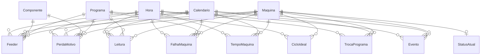

# SFCS_Producao — guia do dashboard

O dashboard **SFCS_Producao** mostra a produção das máquinas de montagem SMT (insersoras JUKI KE2060/KE2080, Hitachi SIG200A e Panasonic HT122) das linhas L05 a L14:

- quantas placas cada linha produz;
- quanto tempo as máquinas ficam paradas;
- quantos componentes se perdem;
- quanto tempo levam as trocas de programa;
- se a coleta de dados está funcionando;
- a confiabilidade das máquinas (MTBF/MTTR) e o OEE.

| Item | Onde fica |
|---|---|
| Relatório (Power BI Project) | [`powerbi/SFCS_Producao.pbip`](../../SFCS_Producao.pbip) |
| Banco lido pelo relatório | `SFCS_DW`, views do schema `bi` ([`04_CriarViewsBI.sql`](../../../etl/SFCS_ETL/SQL/04_CriarViewsBI.sql)) |
| Carga do banco | pacote SSIS [`etl/SFCS_ETL`](../../../etl/README.md), a partir do MongoDB (coleções `SPEND` e `WATCH` de cada `thread_NN`) |
| Gerador do relatório | [`powerbi/tools/gerar_pbip.py`](../../tools/gerar_pbip.py) |

---

## 1. Como usar

1. Abra `SFCS_Producao.pbip` no Power BI Desktop (2025 ou posterior) e clique em **Atualizar**. O projeto é salvo sem dados.
2. Navegue pelo **menu lateral** à esquerda. No Desktop, use **Ctrl + clique** nos botões; no serviço do Power BI e no link público, basta um clique.
3. Os filtros no topo de cada página (**Linha, Máquina, Período e Turno**) são **sincronizados**: o que você escolhe numa página vale para todas.
4. Para usar outro servidor ou banco, vá em **Transformar dados → Editar parâmetros** e altere `Servidor` (padrão `localhost`) e `Banco` (padrão `SFCS_DW`).

O relatório tem páginas de 1920 × 1080 e fontes 30% maiores que o padrão do Power BI, para leitura em tela cheia.

### Três regras para ler os números

- **Produção da linha não é a soma das máquinas.** A mesma placa passa por todas as máquinas da linha. Por isso a medida `Placas` usa a maior contagem entre as máquinas da linha.
- **Só as KE informam tempos.** As SIG200A e HT122 enviam os tempos zerados. Disponibilidade, MTBF, MTTR e OEE ficam **em branco** para elas, e não em zero.
- **Os horários são locais** (Manaus, `SA Western Standard Time`). Os turnos padrão são 06–14 (1º), 14–22 (2º) e 22–06 (3º).

---

## 2. Páginas

### 2.1 Visão Geral

Resumo da produção e da situação das máquinas.

| Visual | O que mostra |
|---|---|
| Cartões | `Placas`, `Disponibilidade %`, `Taxa de Perda %`, `Trocas`, `Falhas de Coleta`, `Interlocks` |
| Placas por linha | Colunas por linha, da que mais produziu para a que menos produziu |
| Placas por hora e linha | Linha do tempo hora a hora, uma série por linha. Mostra quedas e paradas ao longo do dia. |
| Status atual das máquinas | Uma linha por máquina: programa em execução, situação da coleta, última leitura com sucesso, última falha e a mensagem dela |

### 2.2 Produção

Volume e ritmo de produção.

| Visual | O que mostra |
|---|---|
| Cartões | `Placas`, `Placas por Hora Rodando`, `Componentes por Placa`, `Place` |
| Placas por máquina | Barras por máquina. Máquinas da mesma linha devem ter contagens parecidas; se uma destoar, há falha de coleta ou contador. |
| Placas por turno | Comparação entre turnos |
| Placas por hora do dia | Perfil médio do dia, das 00h às 23h |
| Placas por máquina e dia | Matriz máquina × data |
| Produção por programa | Programa (arquivo `.E46`, `.E48`, `.PW4`), produto, placas, ritmo e componentes por placa |

### 2.3 Perdas de Componentes

Componentes que a máquina coletou mas descartou (falha de vácuo, de visão, falta de componente etc.).

| Visual | O que mostra |
|---|---|
| Cartões | `Picked (feeders)`, `Missed (feeders)`, `Taxa de Perda %`, `Perdas PPM` |
| Taxa de perda por máquina | Máquinas ordenadas pela maior taxa |
| Componentes com mais perdas | Código do componente e quantidade perdida |
| Ocorrências por motivo | NoComp, ErrorVac, Vision, DiffComp etc. Um pick perdido pode registrar mais de um motivo. |
| Feeders com mais perdas | Máquina, posição do feeder (lado F/R + posição), componente, picked, missed e taxa. É a lista de ação para a manutenção de feeders. |
| Taxa de perda por hora do dia | Mostra se as perdas se concentram em algum horário |

### 2.4 Disponibilidade (KE)

Tempo produzindo e tempo parado das máquinas KE.

| Visual | O que mostra |
|---|---|
| Cartões | `Disponibilidade %`, `Horas Rodando`, `Horas Paradas`, `Reinícios de Contador` |
| Disponibilidade por máquina | Máquinas ordenadas da pior para a melhor |
| Horas por categoria | Rodando, Parado e as causas de parada: sem componente, parada parcial, falha, reparo, espera de placa na entrada e na saída. **As causas se sobrepõem**: compare umas com as outras, mas não some. |
| Disponibilidade por hora | Evolução hora a hora |
| Horas por máquina e categoria | Matriz máquina × categoria de tempo |

### 2.5 Trocas de Programa

Mudanças de programa (setup) e o tempo perdido em cada uma.

| Visual | O que mostra |
|---|---|
| Cartões | `Trocas`, `Tempo Médio de Troca (min)`, `Tempo Total de Troca (h)` |
| Trocas por máquina | Quantidade de trocas |
| Tempo médio de troca por máquina | Minutos por troca |
| Histórico de trocas | Data e hora, linha, máquina, programa anterior, programa novo, produto e minutos. O tempo vai da última placa do programa anterior até a primeira placa do novo, com precisão de cerca de 2 minutos (o intervalo de coleta). |

### 2.6 Coleta e Interlock

Saúde da coleta de dados e eventos do sistema SFCS.

| Visual | O que mostra |
|---|---|
| Cartões | `Falhas de Coleta`, `Falhas de Consumo`, `Interlocks`, `% Máquinas com Coleta OK` |
| Eventos por linha e tipo | Colunas empilhadas por tipo de evento |
| Eventos por hora | Linha do tempo por tipo |
| Mensagens mais frequentes | Texto do erro e quantidade, como timeout, HTTP 406 e "Feeder não encontrado" |
| Situação da coleta por máquina | Máquinas com a coleta falhando aparecem primeiro |

Tipos de evento:

| Tipo | Significado |
|---|---|
| **Falha de coleta** | O coletor não conseguiu ler a máquina (timeout, conexão recusada, erro de leitura). Os números de produção desse período ficam incompletos. |
| **Falha de consumo** | Um pick foi lido, mas o feeder não foi encontrado no setup cadastrado. Indica divergência entre setup e máquina. |
| **Interlock** | Registros de interlock (auditoria) do SFCS para a máquina. Nos dados atuais são quase todos erros HTTP 406, concentrados na L05. |

### 2.7 Confiabilidade e OEE (KE)

Indicadores de manutenção e de eficiência global das máquinas KE.

| Visual | O que mostra |
|---|---|
| Cartões | `OEE % (sem qualidade)`, `Disponibilidade %`, `Desempenho %`, `Falhas`, `MTBF (h)`, `MTTR (min)` |
| OEE sem qualidade por máquina | Máquinas ordenadas do menor para o maior OEE |
| Paradas por falha | Cada parada por falha ou reparo: início, máquina, tipo (Falha ou Microparada), programa e minutos. As maiores aparecem primeiro. |
| Confiabilidade e OEE por máquina | Falhas, microparadas, MTBF, MTTR, disponibilidade, desempenho e OEE |
| Ciclo de referência | Segundos por placa usados no cálculo do desempenho, por máquina e programa, e quantas horas de dados embasam cada valor |

---

## 3. Medidas

O modelo bloqueia a soma automática de colunas (`discourageImplicitMeasures`). Os números vêm sempre destas medidas. Elas ficam em pastas dentro de cada tabela.

### Produção (tabela `Leitura`)

| Medida | Cálculo | Leitura |
|---|---|---|
| `Placas` | Por linha, a **maior** soma de `QtdPlacas` entre as máquinas da linha; o total soma as linhas | Placas produzidas pela linha. Para uma máquina, é a contagem dela. |
| `Placas Processadas` | `SUM(QtdPlacas)` | Soma das placas de todas as máquinas. Uma placa conta uma vez em cada máquina por onde passa. |
| `Pick` | `SUM(QtdPick)` | Componentes coletados (contador `StoreNum.Pick` da máquina) |
| `Place` | `SUM(QtdPlace)` | Componentes montados |
| `Componentes por Placa` | `Place ÷ Placas` | Densidade média de componentes |
| `Placas por Hora Rodando` | Placas das KE ÷ `Horas Rodando` | Ritmo da máquina enquanto produz |

### Disponibilidade (tabelas `Leitura` e `TempoMaquina`)

| Medida | Cálculo | Leitura |
|---|---|---|
| `Horas Rodando` | `SUM(TempoRodando) ÷ 3600` | `TimeRun` das KE |
| `Horas Paradas` | `SUM(TempoParado) ÷ 3600` | `TimeDown` das KE |
| `Disponibilidade %` | `Rodando ÷ (Rodando + Parado)` | Parcela do tempo **ligado** em que a máquina produziu. Fica em branco para SIG e HT. |
| `Horas por Categoria` | `SUM(Segundos) ÷ 3600` | Horas de cada categoria de tempo. As causas de parada se sobrepõem. |

### OEE (tabela `Leitura`)

| Medida | Cálculo | Leitura |
|---|---|---|
| `Desempenho %` | `Σ(placas × ciclo de referência) ÷ tempo rodando`, limitado a 100% | Quanto do tempo rodando rendeu no ritmo de referência. Só conta programas que têm ciclo de referência. |
| `OEE % (sem qualidade)` | `Disponibilidade % × Desempenho %` | OEE sem o fator qualidade (seção 5) |

### Confiabilidade (tabela `FalhaMaquina`)

| Medida | Cálculo | Leitura |
|---|---|---|
| `Falhas` | Paradas por falha ou reparo **de 5 min ou mais** | Quebras ou ocorrências que exigem intervenção |
| `Microparadas` | Paradas por falha ou reparo de menos de 5 min | Perda de desempenho. Não entram no MTBF nem no MTTR. |
| `Tempo em Falha (h)` | Soma dos minutos das falhas ÷ 60 | |
| `MTBF (h)` | `Horas Rodando ÷ Falhas` | Tempo médio rodando entre falhas. Fica em branco se não houve falha no período. |
| `MTTR (min)` | `minutos em falha ÷ Falhas` | Tempo médio de cada falha. **Inclui a espera pelo técnico**: a máquina não separa espera de reparo. |

O limite de 5 minutos segue a convenção usual do TPM e pode ser alterado na tabela `etl.Configuracao` do `SFCS_DW` (chave `FALHA_MIN_MINUTOS`).

### Perdas (tabelas `Feeder` e `PerdaMotivo`)

| Medida | Cálculo | Leitura |
|---|---|---|
| `Picked (feeders)` | `SUM(Picked)` | Componentes coletados, somados por feeder |
| `Missed (feeders)` | `SUM(Missed)` | Componentes descartados |
| `Taxa de Perda %` | `Missed ÷ Picked` | |
| `Perdas PPM` | `Taxa de Perda × 1.000.000` | Perdas por milhão de picks |
| `Ocorrências de Perda` | `SUM(Ocorrencias)` | Ocorrências por motivo. **Não some com `Missed`**: um pick pode ter vários motivos. |

### Trocas (tabela `TrocaPrograma`)

| Medida | Cálculo |
|---|---|
| `Trocas` | Quantidade de trocas de programa |
| `Tempo Médio de Troca (min)` | Média de `MinutosTroca` |
| `Tempo Total de Troca (h)` | Soma de `MinutosTroca` ÷ 60 |

### Eventos e status (tabelas `Evento` e `StatusAtual`)

| Medida | Cálculo |
|---|---|
| `Eventos` | Quantidade de eventos |
| `Falhas de Coleta`, `Falhas de Consumo`, `Interlocks` | `Eventos` filtrado pelo tipo |
| `Máquinas` | Máquinas com status registrado |
| `Máquinas com Coleta OK` | Máquinas cuja última tentativa de coleta funcionou |
| `% Máquinas com Coleta OK` | `Máquinas com Coleta OK ÷ Máquinas` |

### Qualidade dos dados (tabela `Leitura`)

| Medida | Leitura |
|---|---|
| `Leituras` | Leituras de máquina carregadas, sem as repetidas |
| `Reinícios de Contador` | Vezes em que o contador da máquina recomeçou (nova produção, troca, reinício). Muitos reinícios merecem investigação. |

---

## 4. Modelo semântico

Modelo em estrela, em modo **Import**, compatibilidade 1600, cultura pt-BR. Cada tabela importa uma view do schema `bi` do `SFCS_DW` pelos parâmetros `Servidor` e `Banco`.



Todos os relacionamentos são um-para-muitos, com filtro da dimensão para o fato, e usam as chaves `MaquinaKey`, `ProgramaKey`, `ComponenteKey`, `DataKey` e `HoraKey`. As chaves e os campos técnicos ficam ocultos.

### Dimensões

| Tabela | Grão | Colunas principais |
|---|---|---|
| `Maquina` | 1 máquina por linha | `Linha` (L05…L14), `Modulo` (KE2060-12), `LinhaModulo` ("L08 · KE2060-12", usada nos filtros porque há módulos com o mesmo nome em linhas diferentes), `Familia`, `Modelo`, `IpModulo`, `InformaTempos` (Sim para KE, Não para SIG e HT), `Thread` (banco Mongo de origem) |
| `Programa` | 1 programa de montagem | `Programa` (arquivo, ex.: `P26-03401M.E46`), `Produto` (placa) |
| `Componente` | 1 código de componente | `Componente` (código do fornecedor) |
| `Calendario` | 1 dia | `Data`, `Ano`, `Mes`, `NomeMes`, `AnoMes`, `Dia`, `NomeDiaSemana`. Vai do primeiro dia com leituras até o último dia com dados. |
| `Hora` | 1 hora do dia (0–23) | `Hora` ("06:00"), `Turno` |

### Fatos

| Tabela | Grão | Conteúdo |
|---|---|---|
| `Leitura` | 1 leitura da máquina (~2 min), sem as repetidas | Diferença desde a leitura anterior: placas, pick, place, missed e os tempos (rodando, parado, falha, reparo, sem componente, parada parcial, espera de entrada e de saída). Traz também `TempoIdeal` e `TemCiclo` para o desempenho e marcadores de qualidade do dado (`Reinicio`, `TrocaPrograma`, `ContadorRetomado`, `DadoSuspeito`). |
| `Feeder` | máquina × feeder × componente × hora | Picked, Placed e Missed por feeder (lado F/R + posição) |
| `PerdaMotivo` | máquina × componente × motivo × hora | Ocorrências por motivo de perda (os 10 motivos do contador da máquina) |
| `TempoMaquina` | máquina × categoria × hora | Segundos por categoria de tempo (só KE) |
| `TrocaPrograma` | 1 troca | Programa anterior → novo, produto e minutos de troca |
| `Evento` | 1 evento | Falhas de coleta, falhas de consumo e interlocks, com mensagem, lado, slot, feeder e código do fornecedor |
| `StatusAtual` | 1 máquina | Foto da última coleta: programa atual, situação da coleta, última falha e contadores acumulados |
| `FalhaMaquina` | 1 parada por falha ou reparo | Início, fim, tipo (Falha ou Microparada), minutos de parada, falha e reparo (só KE) |
| `CicloIdeal` | máquina × programa | Ciclo de referência em segundos por placa e horas de base |

### Como os dados são tratados antes de chegar ao modelo

O ETL (`etl.usp_ProcessarCarga`) faz quatro tratamentos importantes:

- **Contadores viram diferenças.** As máquinas mandam contadores acumulados. A primeira leitura de cada máquina serve de base, com diferença 0.
- **Leituras repetidas são descartadas.** Quando a máquina está parada, ela repete a mesma leitura.
- **Reinícios de contador são reconhecidos.** Isso acontece em nova produção, troca de programa e no "contador retomado", quando a KE volta a um registro de produção antigo. Sem esse tratamento, a L10 apareceria com 17.460 placas em vez de cerca de 1.006.
- **Datas são convertidas** de UTC para o horário local.

Os detalhes estão em [`etl/README.md`](../../../etl/README.md).

---

## 5. Por que o OEE está "sem qualidade"

O OEE completo multiplica três fatores:

```text
OEE = Disponibilidade × Desempenho × Qualidade
Qualidade = placas boas ÷ placas produzidas
```

Neste dashboard, os dois primeiros fatores vêm das próprias máquinas KE:

- **Disponibilidade:** tempo rodando ÷ (rodando + parado).
- **Desempenho:** placas × ciclo de referência ÷ tempo rodando.

O terceiro não pode ser calculado, porque **a base de dados não informa quais placas saíram boas e quais saíram com defeito**:

- **As máquinas só contam.** As insersoras informam quantas placas montaram, não se a placa ficou boa. O defeito é descoberto depois, nas etapas de inspeção e teste.
- **Perda de componente não é defeito de placa.** Quando a máquina falha ao pegar um componente, ela descarta o componente e tenta de novo, e a placa normalmente sai completa. A taxa de perda (~0,11%) mede desperdício de material e de tempo. Usá-la como qualidade daria algo como 99,9% e um OEE com aparência de completo, mas que não mede placas boas.
- **Os dados de qualidade estão em outros sistemas:** SPI (inspeção da pasta de solda), AOI (inspeção óptica depois do forno), teste elétrico ou funcional (ICT/FCT) e registros de retrabalho. Nenhum deles faz parte das bases usadas aqui (MongoDB das máquinas e `Metronome_PRO`).

Na prática, a qualidade entra como **100%**, e o número mostrado é o **limite superior** do OEE real. Por exemplo, com OEE sem qualidade de 85,4% e 2% das placas reprovadas na inspeção, o OEE real seria cerca de 85,4% × 98% ≈ 83,7%. O nome da medida, `OEE % (sem qualidade)`, deixa isso explícito para que ninguém compare o número com metas de OEE completo.

### Outras limitações do OEE desta análise

- **Disponibilidade sobre o tempo ligado.** O OEE clássico usa o tempo planejado de produção, e não há calendário de turnos cadastrado. Máquina desligada ou sem coleta não conta como parada.
- **Ciclo de referência é taxa demonstrada.** Não existe ciclo padrão de engenharia por programa nas bases. O ciclo usado é o percentil 10 dos segundos por placa observados em cada máquina e programa, em horas com pelo menos 5 placas e 10 minutos rodando. Por isso o desempenho fica perto de 100% e mede só a variação em relação ao melhor ritmo já visto, não em relação ao padrão.
- **Só máquinas KE.** SIG200A e HT122 não informam tempos.

### Como completar o OEE

1. **Integrar a inspeção ou o teste.** AOI e testadores costumam exportar resultados com placa, programa, linha, data e aprovada ou reprovada. Com uma tabela de reprovações por linha, programa e hora, o modelo ganha a medida `Qualidade %`, e o OEE passa a ser completo.
2. **Lançamento manual, como solução provisória.** Uma tabela simples de placas reprovadas por linha, turno e dia, preenchida pela qualidade, já permite calcular o fator.
3. **Ciclo padrão.** Se a engenharia fornecer o tempo padrão por programa, basta trocar a view `bi.CicloIdeal`, e o desempenho passa a ser medido contra o padrão.

---

## 6. Manutenção do relatório

O `.pbip` é gerado por [`gerar_pbip.py`](../../tools/gerar_pbip.py), que lê os tipos das colunas das views `bi.*`:

```powershell
python powerbi\tools\gerar_pbip.py --servidor localhost --banco SFCS_DW
```

O gerador **sobrescreve** as pastas `SFCS_Producao.Report` e `SFCS_Producao.SemanticModel`. Depois que o relatório passar a ser editado no Power BI Desktop, deixe de usar o gerador. Este guia fica fora dessas pastas para não ser apagado.
